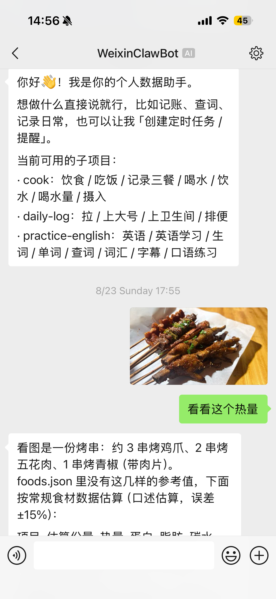
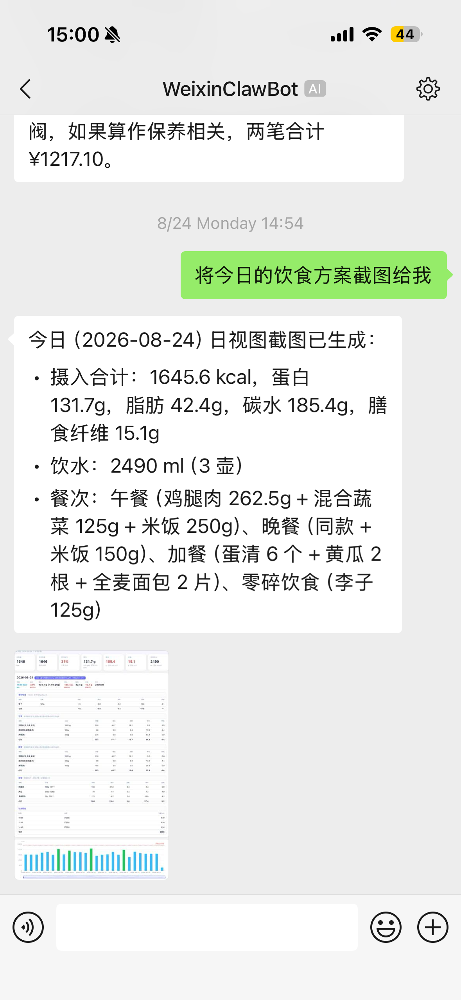
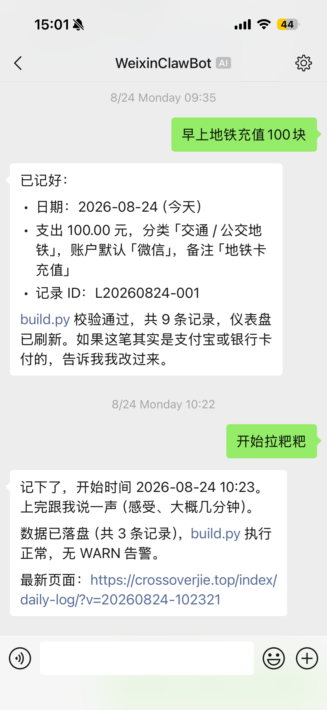
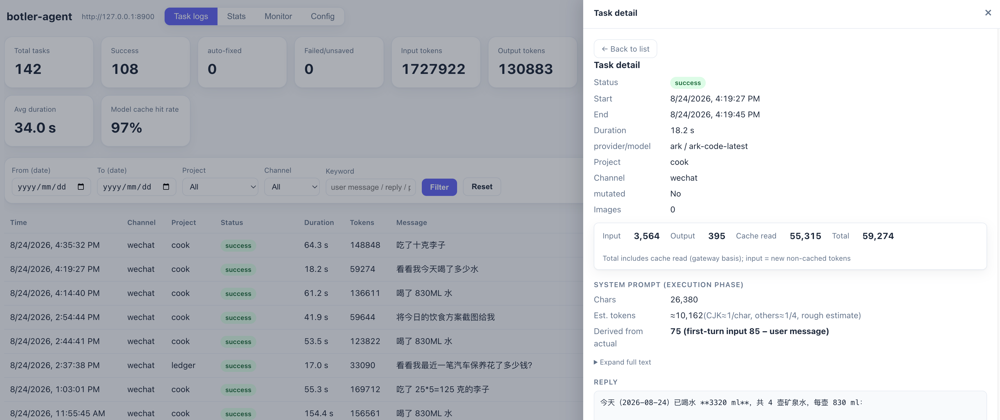

# botler-agent

[](https://codecov.io/gh/crossoverJie/botler-agent)
[)](https://codecov.io/gh/crossoverJie/botler-agent)

> 🌐 [English](README.md) · 📖 [配置与参考手册](docs/configuration-zh.md)

<p align="center">
  
  
  
</p>

通用轻量个人 Agent 框架：从 **Telegram / 飞书 / 微信（iLink）** 接收消息，在数据根目录（`DATA_ROOT`）下的各数据子项目中自主完成短任务并回发结果；内置可选的定时调度器、本地 WebUI 与健康度监控。

- **框架只定义边界**：`DATA_ROOT` 一级子目录白名单、6 个受控工具（`read / write / edit / run / schedule` + IM 专属 `clear_conversation_context`）、写后校验 JSON 合法、有改动自动 `git commit`。
- **业务规则由数据项目自描述**：每个子项目根目录的 `AGENTS.md` 描述自身的文件结构与操作规则；框架不硬编码任何具体业务。
- **提示词与配置外置**：统一存放在 `~/.botler-agent/`，可跨目录、跨机器直接复用。

## 为什么选 botler-agent？

- **极简轻量** — 单个静态 Go 二进制 + 6 个受控工具，无重型运行时或后台依赖，秒级安装。
- **极致省 Token** — 每次任务都是全新短命 `Agent`（仅复用受限的最近可见对话轮次）；两阶段路由只加载目标子项目的 `AGENTS.md`，日常开销仅为通用助手的零头。
- **聚焦垂直日常任务** — 专为饮食营养、个人记账、日常笔记、生词本、定时提醒等边界清晰的小任务设计，数据本地结构化可控。

| | **botler-agent** | **通用 Agent**（OpenClaw / WorkBuddy） | **Coding Agent**（Claude Code / Codex） | **云端聊天机器人**（豆包 / 元宝 / ChatGPT） |
|---|---|---|---|---|
| **定位** | 轻量个人数据助手 | 通用任务自动化 | 代码库内的软件工程 | 对话式问答服务 |
| **安装体积** | 单个静态 Go 二进制，秒级安装 | 安装包庞大，冗余功能多 | 较重，依赖完整开发环境 | 网页 / App，无需安装 |
| **内置工具** | 仅 6 个受控工具（`read/write/edit/run/schedule` + `clear_conversation_context`） | 内置大量复杂工具 | 完整的 shell、文件系统与命令权限 | 仅对话，无本地文件工具 |
| **文件与本机权限** | 路径白名单（仅限 `DATA_ROOT` 一级子目录）；无任意 shell | 文件与本机权限较开放 | 可读写整个工作区并执行任意命令 | 无（纯云端服务） |
| **交互方式** | 移动端优先：微信 / Telegram / 飞书 | 多端 | 以桌面 / 终端为主 | 网页 / App 聊天 |
| **数据存储** | 本地优先：存于 `DATA_ROOT`，结构化且 Git 版本化 | 取决于平台 | 代码仓库内 | 仅在云端，多为非结构化聊天记录 |

## 快速开始

### 方式 A — 源码编译安装（推荐）

```bash
# 克隆至 ~/.local/share/botler-agent，编译静态 Go 二进制并执行 `botler init`（可重复执行以更新）
git clone https://github.com/crossoverJie/botler-agent.git
cd botler-agent && go run ./scripts/install

# 或在当前目录就地编译：
go build -o botler ./cmd/botler && ./botler init
```

完成配置并启动：

```bash
# 1. 编辑 ~/.botler-agent/.env（填写 DATA_ROOT、PI_PROVIDER / PI_MODEL 及渠道凭据）
# 2.（可选）编辑 ~/.botler-agent/providers.json 配置自定义 OpenAI / Anthropic 兼容网关
# 3.（可选）微信 iLink 渠道扫码登录：
botler wechat-login

# 4a. CLI 模式（单条消息本地调试）
botler "早上吃了个馒头"

# 4b. 常驻服务模式（按 .env 启动消息渠道 / 调度器 / WebUI）
botler
# 或在仓库目录管理后台进程：go run ./scripts/botlerctl restart
```

### 方式 B — Docker 部署（NAS / 容器）

Docker Hub 已发布多架构镜像 `crossoverjie/botler-agent`（`linux/amd64` + `linux/arm64`，标签 `latest` / `edge` / `vX.Y.Z`），通过 `/config` 与 `/data` 两个挂载卷持久化全部状态：

```bash
# 1. 生成初始配置模板到 ./config
docker run --rm -v "$PWD/config:/config" crossoverjie/botler-agent:latest init

# 2. 编辑 ./config/.env（配置 PI_PROVIDER / PI_MODEL 与渠道凭据）

# 3. 启动容器（镜像默认已开启 WebUI :8900、调度器与健康监控 :8899）
docker run -d --name botler --restart unless-stopped \
  -e TZ=Asia/Shanghai \
  -p 8900:8900 \
  -v "$PWD/config:/config" \
  -v "$PWD/data:/data" \
  crossoverjie/botler-agent:latest
```

> **容器内开启 `GIT_PUSH=1`**：容器环境变量优先级高于 `/config/.env`。关于 Docker Compose 编排、SSH 密钥挂载、Git 提交身份与 NAS 权限配置，请参阅 **[容器内 git push 指南](docs/docker-git-push.md)**。

## 示例数据模板（`botler-agent-app`）

botler-agent 不强制固定数据格式。如需开箱即用的结构化模板——`cook`（饮食营养）、`daily-log`（日常记录）、`ledger`（个人记账）、`travel`（旅行见闻），可将 [`botler-agent-app`](https://github.com/crossoverJie/botler-agent-app) 克隆作为你的 `DATA_ROOT`（本仓库内的同名 submodule 仅作展示）：

```bash
git clone https://github.com/crossoverJie/botler-agent-app.git /path/to/your/data-root
export DATA_ROOT=/path/to/your/data-root
```

## 架构与安全边界

```text
Telegram / 飞书 / 微信（iLink）
      │  消息
      ▼
 Channel Adapter ──► Dispatcher（5 分钟去重 + 串行队列，避免并发写冲突）
                        │
                        ▼
                  Runner（两阶段：路由 → 执行）
                        ├─ ① 路由：基于轻量摘要判断目标子项目（或 __scheduler__）
                        ├─ ② 执行：新建独立 Agent + 按需注入子项目 AGENTS.md + 受控工具集
                        │
                        ▼
                  Validator（校验所有数据 JSON 语法合法，失败则自愈修复一次）
                        │
                        ▼
                  Git Commit（遍历 DATA_ROOT 下各独立 Git 仓库，有改动才提交；可选 push）
                        │
                        └──► 文本回复（微信渠道支持同时发送图片）

Scheduler ──► dispatch(schedule.message) ──► deliver() 推送（主渠道 → telegram → feishu → wechat 兜底）
```

- **应用与数据分离**：框架代码、密钥与 `DATA_ROOT` 物理隔离，数据目录内只有纯数据子项目。
- **严格路径白名单**：`safePath()` 仅放行 `DATA_ROOT` 下的一级子目录，并对最深已存在祖先执行 `realpath` 校验以防止符号链接逃逸。
- **禁止任意 Shell**：`run` 仅允许直接执行白名单项目内已有的 `.py`/`.js`/`.mjs` 脚本（不经 shell，60s 超时）；`schedule` 仅读写固定的 `schedules.json`；`clear_conversation_context` 仅重置当前 IM 会话窗口。

## 核心功能速览

- **多消息渠道**（[详情](docs/configuration-zh.md#消息渠道telegram--飞书--微信)）：支持 **Telegram**（长轮询 + 代理）、**飞书**（事件 Webhook 含解密）与 **微信 iLink**（扫码登录、入站图片视觉识别与图文批处理合并、出站发图、24h 会话续期提醒），内置零成本问候短路与最近对话上下文。
- **模型网关与自动容灾**（[详情](docs/configuration-zh.md#自定义模型供应商providersjson)）：内置 `anthropic` 之外，可在 `providers.json` 中配置任意 `openai-completions` / `anthropic-messages` 兼容网关，支持流式中断重试与多供应商优先级 Fallback 链。
- **定时调度器**（[详情](docs/configuration-zh.md#定时调度器schedulesjson)）：支持 `cron` / `interval` / `at` / `once` 四类触发器、免打扰时间窗、失败重试、多渠道兜底推送，以及中国法定工作日门控（`holidayMode: "workday"`，自动跳过法定节假日并识别调休补班）。
- **WebUI 与监控**（[详情](docs/configuration-zh.md#webui-与健康度监控)）：提供本地任务日志与 Token 统计界面（`127.0.0.1:8900`）及 Prometheus/JSON 健康度端点（`127.0.0.1:8899` `/healthz`、`/metrics`）。

<p align="center">
  
</p>

## 配置与相关文档

`~/.botler-agent/`（可用 `BOTLER_CONFIG_DIR` 覆盖）核心文件速览：

| 路径 | 作用 |
|------|------|
| `.env` | 核心配置（`DATA_ROOT`、`PI_PROVIDER`/`PI_MODEL`、渠道凭据与功能开关）——参考 [`.env.example`](.env.example) |
| `providers.json` | 自定义模型网关、识图开关与多供应商 Fallback 优先级 |
| `system-prompt.md` | 可定制的全局系统提示词（支持 `__DATA_ROOT__` / `__PROJECTS__` / `__PROJECT_CONTEXT__` / `__TODAY__`） |
| `schedules.json` | 定时任务存储（可通过聊天指令、WebUI 或手改维护） |
| `contacts.json` / `wechat/` / `task-logs/` | 推送联系地址、微信登录凭据与按日 JSONL 任务日志 |

- **[配置与参考手册](docs/configuration-zh.md)** — `providers.json`、`schedules.json`、各渠道细节、系统提示词定制与全量环境变量表
- **[容器内 `GIT_PUSH=1` 部署指南](docs/docker-git-push.md)** — Docker Compose 编排、SSH 密钥挂载与 NAS 权限说明
- **[`AGENTS.md`](AGENTS.md)** — 代码库架构、Go 模块划分、测试命令与开发者说明

## 许可证

[AGPL-3.0](LICENSE)（GNU Affero General Public License v3）。第三方依赖许可证声明见 [`THIRD-PARTY-LICENSES`](THIRD-PARTY-LICENSES)。

> **AGPL 提示**：若你将**修改过**的 botler-agent 作为网络服务运行（如公开机器人），须向与之交互的用户提供相应源代码。
