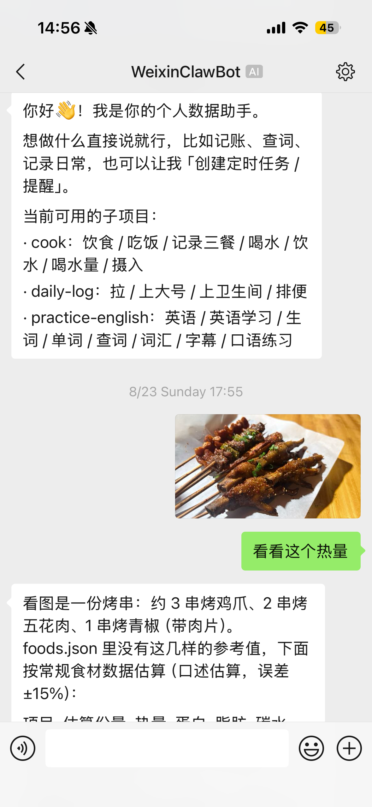
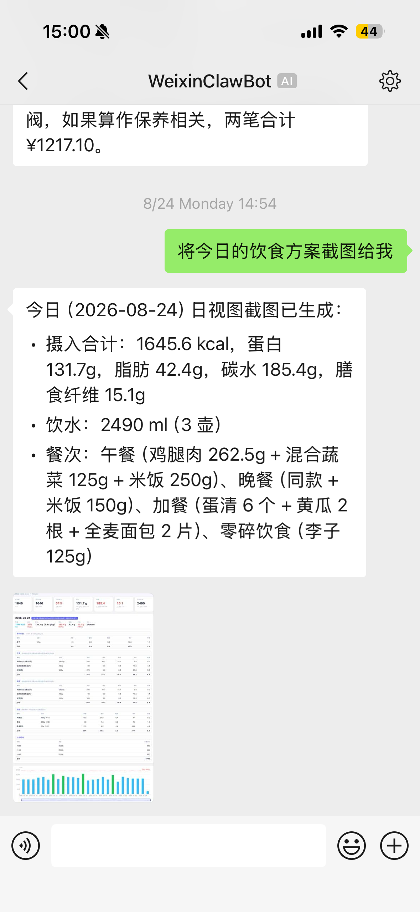
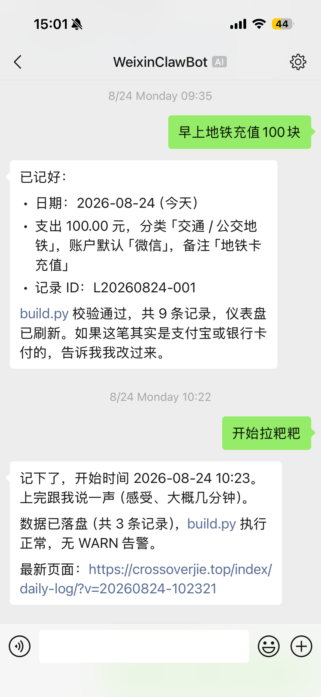
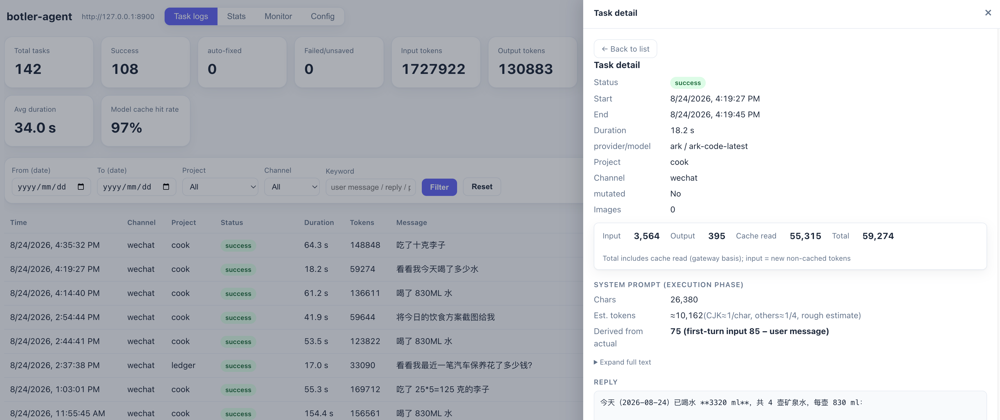

# botler-agent

[](https://codecov.io/gh/crossoverJie/botler-agent)
[)](https://codecov.io/gh/crossoverJie/botler-agent)

> 🌐 [中文文档](README-ZH.md) · 📖 [Configuration Guide](docs/configuration.md)

<p align="center">
  
  
  
</p>

A general-purpose, lightweight personal agent framework: it receives messages from **Telegram / Feishu / WeChat (iLink)**, autonomously completes short tasks within each data subproject under `DATA_ROOT`, and replies to the user — with an optional in-process scheduler, local WebUI, and health/metrics monitor.

- **The framework only defines boundaries**: first-level `DATA_ROOT` directory allowlist, six controlled tools (`read / write / edit / run / schedule` + IM-only `clear_conversation_context`), post-write JSON validation, and automatic `git commit` on changes.
- **Business rules are self-described by data projects**: each subproject's root `AGENTS.md` defines its own schema and rules; the framework hardcodes no business logic.
- **Prompts and config are externalized**: stored in `~/.botler-agent/`, reusable across clones and machines.

## Why botler-agent?

- **Lightweight** — a single static Go binary with six controlled tools; no heavy runtime or daemon, installed in seconds.
- **Token-thrifty** — every task spawns a fresh, short-lived `Agent` with a bounded recent-turn window. Two-phase routing loads *only* the selected subproject's `AGENTS.md`, costing a fraction of a general-purpose assistant.
- **Focused on vertical daily tasks** — built for small, repetitive, well-scoped jobs (meal logging, ledger entries, vocab lookups, reminders) with structured local storage.

| | **botler-agent** | **General-purpose agents** (OpenClaw / WorkBuddy) | **Coding agents** (Claude Code / Codex) | **Cloud chatbots** (Doubao / Yuanbao / ChatGPT) |
|---|---|---|---|---|
| **Positioning** | Lightweight personal data assistant | Broad task automation | Software engineering in a codebase | Conversational Q&A service |
| **Install footprint** | Single static Go binary, installed in seconds | Large bundles with many unused features | Heavy; expects a full dev environment | Web / app — nothing to install |
| **Built-in tools** | 6 controlled tools (`read/write/edit/run/schedule` + `clear_conversation_context`) | Many complex built-in tools | Full shell, filesystem, and command access | Chat only — no file tools |
| **File & host permissions** | Path allowlist (`DATA_ROOT` first-level subdirs only); no arbitrary shell | Broad file & host access | Reads/writes workspace; runs arbitrary commands | N/A (remote cloud service) |
| **Interaction** | Mobile-first: WeChat / Telegram / Feishu | Multi-surface | Desktop / terminal-centric | Web / app chat |
| **Data storage** | Local-first in `DATA_ROOT`, structured & Git-versioned | Platform-dependent | In codebase / repo | Cloud-only, unstructured chat history |

## Quick Start

### Option A — Build from source (recommended)

```bash
# Clone to ~/.local/share/botler-agent, build static Go binary, and run `botler init` (idempotent)
git clone https://github.com/crossoverJie/botler-agent.git
cd botler-agent && go run ./scripts/install

# Or build in place:
go build -o botler ./cmd/botler && ./botler init
```

Then configure and run:

```bash
# 1. Edit ~/.botler-agent/.env (set DATA_ROOT, PI_PROVIDER / PI_MODEL, and channel credentials)
# 2. (Optional) Edit ~/.botler-agent/providers.json for custom OpenAI / Anthropic gateways
# 3. (Optional) Log in to WeChat iLink via terminal QR code:
botler wechat-login

# 4a. CLI mode (single message for local debugging)
botler "had a steamed bun for breakfast"

# 4b. Persistent service mode (starts configured channels / scheduler / WebUI)
botler
# Or manage background daemon in-repo: go run ./scripts/botlerctl restart
```

### Option B — Docker (NAS / container deployment)

Multi-arch images (`linux/amd64`, `linux/arm64`) are published at `crossoverjie/botler-agent` (`latest` / `edge` / `vX.Y.Z`), persisting config in `/config` and data in `/data`:

```bash
# 1. Scaffold config templates into ./config
docker run --rm -v "$PWD/config:/config" crossoverjie/botler-agent:latest init

# 2. Edit ./config/.env (set PI_PROVIDER / PI_MODEL and channel credentials)

# 3. Start container (WebUI :8900, scheduler, and monitor :8899 are enabled by default)
docker run -d --name botler --restart unless-stopped \
  -e TZ=Asia/Shanghai \
  -p 8900:8900 \
  -v "$PWD/config:/config" \
  -v "$PWD/data:/data" \
  crossoverjie/botler-agent:latest
```

> **Container `GIT_PUSH=1`**: image env defaults take precedence over `/config/.env`. For Docker Compose setup, SSH key mounts, commit identity, and NAS permissions, see **[Git push from the container](docs/docker-git-push.md)**.

## Example Data Templates (`botler-agent-app`)

botler-agent enforces no fixed schema. For ready-to-use structured templates — `cook` (nutrition/meals), `daily-log`, `ledger` (accounting), and `travel` — clone [`botler-agent-app`](https://github.com/crossoverJie/botler-agent-app) into your `DATA_ROOT` (the submodule in this repo is for discovery only):

```bash
git clone https://github.com/crossoverJie/botler-agent-app.git /path/to/your/data-root
export DATA_ROOT=/path/to/your/data-root
```

## Architecture & Security Boundaries

```text
Telegram / Feishu / WeChat (iLink)
      │  message
      ▼
 Channel Adapter ──► Dispatcher (5m dedup + serial queue to prevent concurrent write conflicts)
                        │
                        ▼
                  Runner (two-phase: route → execute)
                        ├─ ① route: pick subproject (or __scheduler__) from lightweight summaries
                        ├─ ② execute: fresh Agent + selected subproject's AGENTS.md + controlled tools
                        │
                        ▼
                  Validator (verify all data JSON syntax; self-heal once on broken edit)
                        │
                        ▼
                  Git Commit (commit changed independent git repos under DATA_ROOT; optional push)
                        │
                        └──► Reply text (WeChat also delivers images)

Scheduler ──► dispatch(schedule.message) ──► deliver() push (primary → telegram → feishu → wechat)
```

- **App / data separation**: framework code and secrets live outside `DATA_ROOT`; `DATA_ROOT` holds only plain data subprojects.
- **Strict path allowlist**: `safePath()` restricts file access to first-level subdirs of `DATA_ROOT`, resolving the deepest existing ancestor via `realpath` to block symlink escapes.
- **No arbitrary shell**: `run` only executes existing `.py`/`.js`/`.mjs` scripts inside allowlisted projects without a shell (60s timeout); `schedule` only writes `~/.botler-agent/schedules.json`; `clear_conversation_context` only resets the active IM window.

## Core Capabilities

- **Channels** ([details](docs/configuration.md#channels-telegram--feishu--wechat)): **Telegram** (long polling + proxy support), **Feishu** (encrypted webhook), and **WeChat iLink** (QR login, inbound vision photos with caption batching, outbound image replies, 24h session renewal reminders). Includes zero-cost greeting short-circuit and shared recent-turn context.
- **Models & Fallback** ([details](docs/configuration.md#custom-model-providers-providersjson)): built-in `anthropic` plus custom `openai-completions` and `anthropic-messages` gateways in `providers.json`, with stream-aware retries and automatic multi-provider priority fallback.
- **Scheduler** ([details](docs/configuration.md#scheduler-schedulesjson)): in-process `cron` / `interval` / `at` / `once` triggers in `schedules.json`, supporting silent hours, retries, multi-channel fallback push, and China legal-workday gating (`holidayMode: "workday"`).
- **WebUI & Monitor** ([details](docs/configuration.md#webui--monitor)): local task-log & token-stats WebUI (`127.0.0.1:8900`) and Prometheus/JSON health endpoints (`127.0.0.1:8899` `/healthz`, `/metrics`).

<p align="center">
  
</p>

## Configuration & Documentation

User-level files under `~/.botler-agent/` (override via `BOTLER_CONFIG_DIR`):

| Path | Purpose |
|------|---------|
| `.env` | Core settings (`DATA_ROOT`, `PI_PROVIDER`/`PI_MODEL`, channels, feature flags) — see [`.env.example`](.env.example) |
| `providers.json` | Custom LLM gateways, vision flags, and fallback priorities |
| `system-prompt.md` | Customizable global prompt template (`__DATA_ROOT__` / `__PROJECTS__` / `__PROJECT_CONTEXT__` / `__TODAY__`) |
| `schedules.json` | Scheduled tasks (managed via chat, WebUI, or file edit) |
| `contacts.json` / `wechat/` / `task-logs/` | Runtime push addresses, WeChat iLink credentials, and daily JSONL logs |

- **[Configuration Guide](docs/configuration.md)** — full reference for `providers.json`, `schedules.json`, channels, system prompt customization, and all environment variables
- **[Docker & `GIT_PUSH=1` Guide](docs/docker-git-push.md)** — container compose setup, SSH keys, and NAS permissions
- **[`AGENTS.md`](AGENTS.md)** — codebase architecture, Go packages, testing, and contributor guide

## License

[AGPL-3.0](LICENSE) (GNU Affero General Public License v3). Third-party dependency licenses are listed in [`THIRD-PARTY-LICENSES`](THIRD-PARTY-LICENSES).
